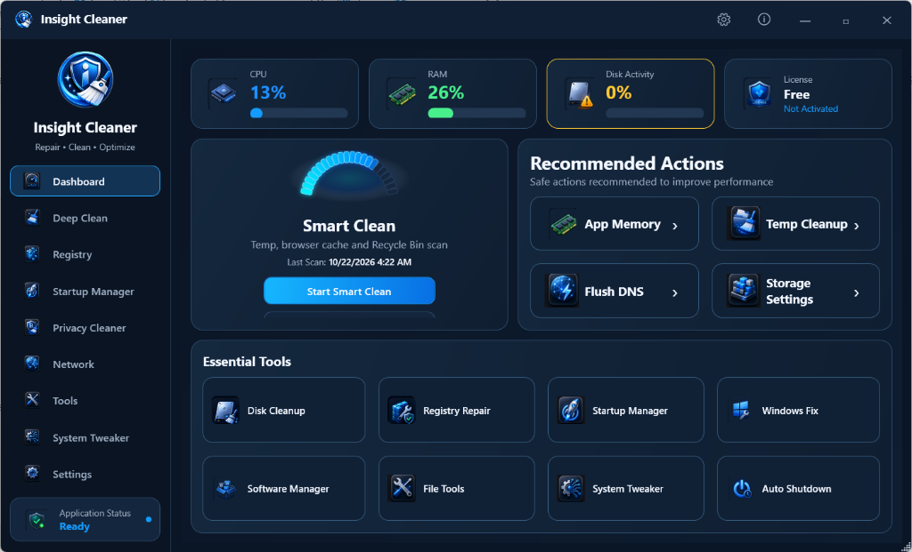

# Insight Cleaner
### Next-Gen System Optimization, Deep Cleaning & Windows Repair Arsenal
**Modern • Safe • High-Performance • Cyber-Dark Aesthetics**

 

---

## 🌟 Overview

**Insight Cleaner** is a modern, enterprise-grade system maintenance and optimization utility engineered for Windows 10 and Windows 11. Designed with a sleek cyber-dark aesthetic and dynamic telemetry widgets, it provides deep drive cleaning, registry repairs, startup management, privacy forensics cleanup, network diagnostics, and safe system repair operations.

Unlike traditional disk cleaners, **Insight Cleaner** features live real-time item removal, interactive radial telemetry gauges, automatic safety backups, and granular one-click repair actions without risky registry bloatware.

---

## ✨ Key Features

### ⚡ 1. Smart Clean & Dynamic Arc Gauge
- **Segmented Arc Telemetry**: Custom 22-segment vector arc gauge that dynamically sweeps and indicates system health with a glowing electric cyan-to-blue gradient.
- **One-Click Optimization**: Scans temporary files, browser caches, and recycle bin candidates with an instant health summary.

### 🧹 2. Deep Clean (Live Real-Time Removal)
- Comprehensive drive hygiene covering Windows caches, thumbnail databases, delivery optimization buffers, and obsolete user logs.
- **Live Progress & Removal**: Elements are pruned from the view in real-time as physical disk bytes are safely reclaimed.

### 🚀 3. Startup Manager
- Inspect startup applications across Registry Run keys, Startup folders, and Task Scheduler.
- **Zero-Friction Control**: Enable, Disable, or Remove entries directly via **mouse row selection** or **right-click context menu** without requiring manual checkbox ticking.

### 🛡️ 4. Registry Cleaner & Safety Safeguards
- Deep structural scanning of missing CLSIDs, invalid file associations, orphaned type libraries, and broken application paths.
- **Automatic Rollback Backups**: Generates point-in-time `.reg` manifests prior to any modification with full restoration capabilities.

### 🔒 5. Privacy Cleaner
- Thorough forensic trace cleansing: activity history, browser cookies, cache files, recent documents, and explorer shell bags.

### 🌐 6. Network Manager & DNS Flush
- Active adapter diagnostics, IP configuration explorer, single-click DNS cache flush, Winsock catalog resets, and TCP/IP stack restoration.

### 🛠️ 7. Essential Tools & Windows Fix Center
- Dedicated utilities for Disk Cleanup, Windows Repair Center, Software Uninstaller, System Tweaker, and automated shutdown schedules.

---

## 📥 Download & Installation

You can download the latest release from the [GitHub Releases](https://github.com/alarifi/insight-cleanner/releases) page.

| Package | Format | Description |
| :--- | :---: | :--- |
| **Official Installer** | `.exe` | Recommended. Installs with desktop & start menu shortcuts, shell context integration, and uninstaller. |
| **Portable Edition** | `.zip` | Zero-install archive. Extract anywhere and launch `InsightCleaner.exe` directly. |

---

## 💻 System Requirements

- **Operating System**: Windows 10 (Build 1809+) or Windows 11 (64-bit).
- **Runtime**: [.NET 8.0 Desktop Runtime](https://dotnet.microsoft.com/download/dotnet/8.0).
- **Privileges**: Administrator rights (required for Windows repair, registry cleaning, and DNS operations).

---

## 📄 License & Attribution

Developed with passion by **INSIGHT Tools** ([insight-ye.com](https://insight-ye.com)).  
All rights reserved. Designed for safe, transparent, and high-performance system maintenance.
